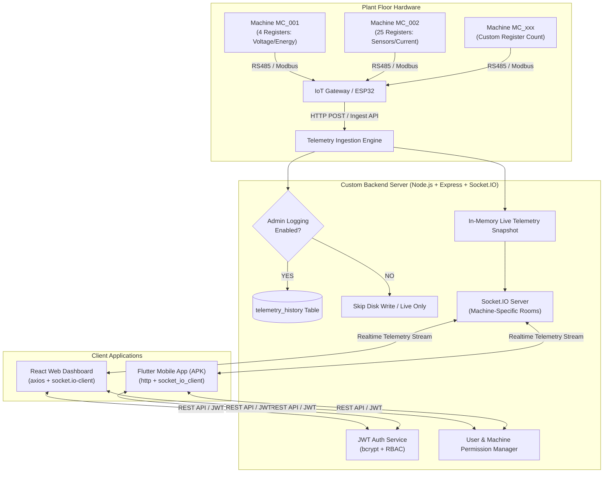
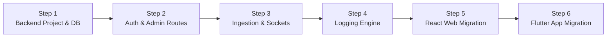

# Comprehensive Implementation Plan: Custom IoT Power Monitoring System

> **Project Scope**: Build a fully owned, high-performance custom backend (Node.js/Express + WebSockets + SQLite/PostgreSQL) to replace Firebase. Supports multi-machine scaling, dynamic per-machine register schemas, 3-tier user access control, and an Admin-controlled conditional data logging engine across the **React Web Dashboard** and **Flutter Mobile App**.

---

## 1. System Topology & Architecture



---

## 2. Complete Database Schema (SQLite / PostgreSQL)

### Table 1: `users`
| Column | Type | Constraints | Description |
| :--- | :--- | :--- | :--- |
| `id` | `INTEGER` / `UUID` | PRIMARY KEY | Unique user ID |
| `email` | `VARCHAR(255)` | UNIQUE, NOT NULL | Login email address |
| `password_hash` | `VARCHAR(255)` | NOT NULL | Bcrypt hashed password |
| `role` | `VARCHAR(32)` | NOT NULL | `'admin'`, `'user_editor'`, or `'user'` |
| `all_machines` | `BOOLEAN` | DEFAULT false | If true, user can view all plant machines |
| `created_at` | `TIMESTAMP` | DEFAULT NOW() | Account creation date |
| `updated_at` | `TIMESTAMP` | DEFAULT NOW() | Last modification timestamp |

### Table 2: `user_machine_assignments`
| Column | Type | Constraints | Description |
| :--- | :--- | :--- | :--- |
| `id` | `SERIAL` | PRIMARY KEY | Record ID |
| `user_id` | `INTEGER` / `UUID` | FK (`users.id`) ON DELETE CASCADE | Target user ID |
| `machine_number`| `INTEGER` | NOT NULL | Machine ID (e.g. 1 for `MC_001`, 2 for `MC_002`) |

*(Unique index on `(user_id, machine_number)` to prevent duplicates).*

### Table 3: `machine_configs` *(Dynamic Per-Machine Setup)*
| Column | Type | Constraints | Description |
| :--- | :--- | :--- | :--- |
| `machine_number`| `INTEGER` | PRIMARY KEY | Numeric ID (1, 2, 3...) |
| `display_name` | `VARCHAR(128)` | NOT NULL | User-friendly name (e.g., "Main Chiller 1") |
| `category` | `VARCHAR(64)` | DEFAULT 'power_meters' | Grouping tab category |
| `is_active` | `BOOLEAN` | DEFAULT true | Soft delete / active state |
| `is_logging_enabled`| `BOOLEAN` | DEFAULT false | **Per-machine logging switch (Admin controlled)** |
| `logging_interval_sec`| `INTEGER` | DEFAULT 60 | Min seconds between database writes (e.g., 30s, 60s) |

### Table 4: `machine_register_definitions` *(Per-Machine Dynamic Registers)*
Stores the custom register definitions for each machine independently:
| Column | Type | Constraints | Description |
| :--- | :--- | :--- | :--- |
| `id` | `SERIAL` | PRIMARY KEY | Definition ID |
| `machine_number`| `INTEGER` | FK (`machine_configs.machine_number`) | Machine this register belongs to |
| `address_key` | `VARCHAR(32)` | NOT NULL | Register address (e.g., `"40001"`, `"30005"`) |
| `display_name` | `VARCHAR(128)` | NOT NULL | Changeable name (e.g., `"Phase R Voltage"`) |
| `unit` | `VARCHAR(16)` | NULLABLE | Measurement unit (`V`, `A`, `kW`, `kWh`, `Hz`, `°C`, `bar`) |
| `group_name` | `VARCHAR(64)` | DEFAULT 'General' | UI Tab/Group (`Voltage`, `Current`, `Power`, `Sensors`) |
| `is_visible` | `BOOLEAN` | DEFAULT true | Visibility toggle |
| `multiplier` | `NUMERIC(6,4)` | DEFAULT 1.0 | Scale multiplier (e.g. 0.1 for 1 decimal point) |

*(Unique constraint on `(machine_number, address_key)`).*

### Table 5: `system_settings`
| Key | Type | Description |
| :--- | :--- | :--- |
| `global_logging_enabled` | `BOOLEAN` | **Master switch: Turn logging ON/OFF plant-wide** |
| `retention_days` | `INTEGER` | Auto-purges logs older than X days (default: 90) |

### Table 6: `telemetry_history` *(Conditional Database Logs)*
| Column | Type | Constraints | Description |
| :--- | :--- | :--- | :--- |
| `id` | `BIGSERIAL` | PRIMARY KEY | Entry ID |
| `machine_number`| `INTEGER` | INDEX, NOT NULL | Machine ID |
| `recorded_at` | `TIMESTAMP` | INDEX, DEFAULT NOW() | Timestamp of reading |
| `raw_registers` | `JSONB` / `TEXT` | NOT NULL | Complete key-value snapshot of all received registers |

---

## 3. The 3 User Access Roles

| Role | Dashboard Telemetry | Settings (⚙️) Button | Change Register Names & Labels | Add / Delete Machines | User Management |
| :--- | :--- | :---: | :---: | :---: | :---: |
| **`user`** *(View Only)* | Assigned machines only | ❌ Hidden | ❌ No (Read-only) | ❌ No | ❌ No |
| **`user_editor`** *(View & Edit)* | Assigned machines only | ✅ Visible | ✅ **Yes** (For assigned machines) | ❌ Hidden | ❌ No |
| **`admin`** *(Full Access)* | All machines | ✅ Visible | ✅ **Yes** (For all machines) | ✅ **Yes** | ✅ **Yes** (Create & Assign) |

---

## 4. Dynamic Per-Machine Register Approach

### The Challenge:
- Machine 1 (`MC_001`) might be a simple 3-phase meter with 4 registers (`40001`, `40003`, `40019`, `40027`).
- Machine 2 (`MC_002`) might be a heavy compressor with 25 registers (`30001` to `30025`, including temperature and pressure sensors).

### The Solution:
1. **Dynamic Ingestion**: Hardware gateway sends key-value JSON for whatever registers it read:
   ```json
   // MC_001 packet
   { "machineNumber": 1, "data": { "40001": 230.5, "40003": 231.2, "40027": 12543.8 } }

   // MC_002 packet
   { "machineNumber": 2, "data": { "30001": 42.5, "30005": 3.8, "30012": 72.4 } }
   ```
2. **Dynamic UI Rendering (Web & Flutter)**:
   - When the user selects `MC_001`, the client fetches `MC_001`'s register schema and renders only those 4 cards.
   - When the user selects `MC_002`, the client renders its 25 cards with appropriate units (`°C`, `bar`, `A`).
   - No blank cards, no hardcoded field errors.

---

## 5. Admin-Controlled Conditional Data Logging

### The Rule:
> **Telemetry is ONLY saved to the database if the Admin enables it.**

```javascript
// Telemetry Ingestion Handler
async function handleIncomingTelemetry(machineNumber, data) {
  // Step 1: ALWAYS stream live to Web & Flutter dashboards in real-time
  io.to(`machine_${machineNumber}`).emit('telemetry_update', {
    machineNumber,
    timestamp: Date.now(),
    data
  });

  // Step 2: Check if logging is turned ON
  const isGlobalOn = await systemSettings.get('global_logging_enabled');
  const machineConfig = await getMachineConfig(machineNumber);

  if (isGlobalOn && machineConfig.is_logging_enabled) {
    const now = Date.now();
    const lastLogged = machineConfig.last_logged_at || 0;

    // Check throttle interval (e.g. log once every 30s or 60s)
    if (now - lastLogged >= machineConfig.logging_interval_sec * 1000) {
      await db.query(
        'INSERT INTO telemetry_history (machine_number, raw_registers, recorded_at) VALUES ($1, $2, NOW())',
        [machineNumber, JSON.stringify(data)]
      );
      machineConfig.last_logged_at = now;
    }
  }
  // If logging is OFF, 0 database writes occur (0 disk space wasted)
}
```

---

## 6. REST API & WebSocket Specifications

### Auth & User Management
* `POST /api/auth/login` &rarr; `{ email, password }` &rarr; Returns JWT token + user role + assigned machines list.
* `GET /api/auth/me` &rarr; Returns active profile & permissions.
* `GET /api/admin/users` *(Admin)* &rarr; List all users, roles, and assigned machines.
* `POST /api/admin/users` *(Admin)* &rarr; Create new user without logging out Admin.
* `PUT /api/admin/users/:id` *(Admin)* &rarr; Update role or machine assignments.
* `DELETE /api/admin/users/:id` *(Admin)* &rarr; Delete user account.

### Machine & Register Management
* `GET /api/machines` &rarr; List all active machines with their register definitions.
* `POST /api/machines` *(Admin)* &rarr; Add a new machine (`MC_004`, `MC_005`, etc.).
* `DELETE /api/machines/:machineNumber` *(Admin)* &rarr; Delete a machine.
* `PUT /api/machines/:machineNumber/registers/:addressKey` &rarr; Edit register display name / custom label (allowed for `admin`, and `user_editor` for assigned units).
* `POST /api/machines/:machineNumber/registers` &rarr; Add a new custom register address to a machine.

### Logging Control (Admin Only)
* `PUT /api/admin/logging/global` &rarr; `{ "enabled": true/false, "retentionDays": 90 }`
* `PUT /api/admin/machines/:machineNumber/logging` &rarr; `{ "enabled": true/false, "intervalSec": 30 }`
* `GET /api/machines/:machineNumber/logs?from=...&to=...` &rarr; Fetch historical logs for charts.
* `GET /api/machines/:machineNumber/logs/export?format=csv` &rarr; Download historical logs as Excel/CSV.

### WebSocket Engine (Socket.IO)
* **Handshake**: Client sends JWT token: `io('http://server:5000', { auth: { token: '...' } })`.
* **Room Join**: Client requests rooms: `socket.emit('join_machines', [1, 2])`.
  - Server verifies client permissions before granting room access.
* **Live Broadcast**: Server emits `telemetry_update` to `machine_{id}` room.

---

## 7. Client Integration Blueprints

### A. React Web Dashboard Integration:
1. Create `src/api/client.js`: Axios instance with JWT interceptor.
2. In `src/contexts/authContext/`: Replace Firebase Auth with `login()`, `logout()`, `currentUser`.
3. In `src/components/home/IotChiller3.jsx`:
   - Replace Firebase `onValue()` with `socket.on('telemetry_update', ...)`.
   - Read dynamic register schema for the selected machine to render cards.
4. In `UserManagerModal.jsx` & `MachineManagerModal.jsx`: Connect to `/api/admin/users` and `/api/machines`.

### B. Flutter Mobile App (APK) Integration:
1. Add dependencies: `http: ^1.2.0`, `socket_io_client: ^3.0.0`, `flutter_secure_storage: ^9.0.0`.
2. Create `AuthService`: Stores JWT token in secure storage; parses role (`admin`, `user_editor`, `user`).
3. Create `SocketService`: Connects with JWT, listens to `telemetry_update` event.
4. In `DashboardScreen.dart`:
   - Render machine tabs filtered to `assignedMachines`.
   - Dynamically build UI grid cards from `machine.registers`.
   - Show Settings (⚙️) only if `role == 'admin' || role == 'user_editor'`.
   - Show Users (👥) only if `role == 'admin'`.

---

## 8. Implementation Steps & Roadmap



1. **Step 1: Backend Scaffolding & Database**:
   - Initialize Node.js + Express project in `d:\TAP\Tap-git\Power-Backend`.
   - Setup SQLite (or PostgreSQL) tables with auto-migration scripts.
2. **Step 2: Authentication & User Management**:
   - Implement bcrypt hashing, JWT middleware, and role guards (`requireAdmin`, `requireEditor`).
   - Implement `/api/auth` and `/api/admin/users` endpoints.
3. **Step 3: Machine & Dynamic Register CRUD**:
   - Create machine configuration endpoints.
   - Allow adding machines and customizing registers per machine.
4. **Step 4: Telemetry Ingestion, Sockets & Conditional Logging**:
   - Implement `/api/telemetry/ingest` endpoint.
   - Setup Socket.IO server with per-machine rooms.
   - Implement the Admin Logging Switch condition (only writes to DB when enabled).
5. **Step 5: React Web App Migration**:
   - Switch React app from Firebase to the custom backend REST + Socket.IO APIs.
6. **Step 6: Flutter Mobile App Sync**:
   - Provide Flutter services and sync the mobile APK with the custom backend.
