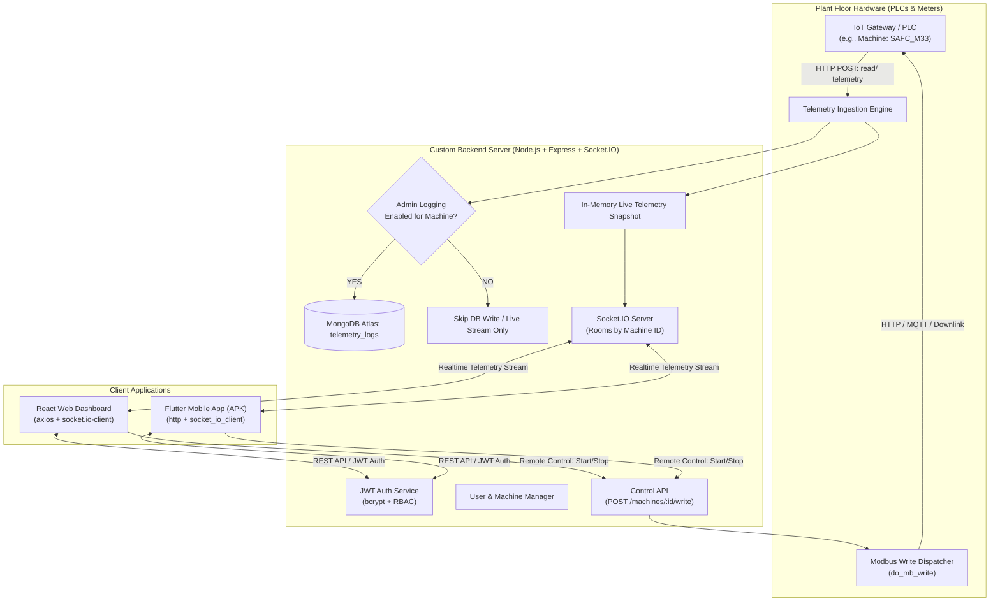
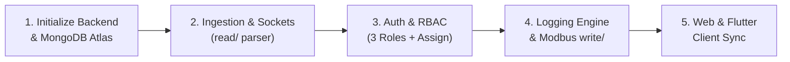

# Comprehensive Implementation Plan: Custom IoT Monitoring & Control System

> **Project Scope**: Build a high-performance, fully owned custom backend (**Node.js/Express + WebSockets + MongoDB Atlas**) to replace Firebase. Supports alphanumeric machine IDs (e.g., `SAFC_M33`), hardware gateway 2-way communication (`read` telemetry + `write` Modbus commands), dynamic per-machine registers, 3-tier user access control, and Admin-controlled conditional data logging across the **React Web Dashboard** and **Flutter Mobile App**.

---

## 1. System Topology & 2-Way Architecture



---

## 2. Updated MongoDB Atlas Database Schema

### Collection 1: `machines`
Stores configuration, friendly names, device mappings, and logging controls for each machine:

```json
{
  "_id": "SAFC_M33",
  "machineId": "SAFC_M33",
  "displayName": "Chiller Unit 33",
  "category": "chillers",
  "deviceId": "plc_device_2CD555577610CB5489A3789152DC0924",
  "isActive": true,
  "isLoggingEnabled": false,
  "loggingIntervalSec": 60,
  "lastSeen": "2026-11-24T08:00:00.000Z",
  "customLabels": {
    "bottle_count": "Main Line Bottle Count",
    "chiller": "Chiller Temp (°C)",
    "pump": "Primary Water Pump",
    "comp": "Main Compressor",
    "fsw_trip": "Flow Switch Alarm",
    "kp1_trip": "Pressure Switch Alarm"
  },
  "createdAt": "2026-11-24T00:00:00.000Z",
  "updatedAt": "2026-11-24T08:00:00.000Z"
}
```

---

### Collection 2: `telemetry_logs` *(Time-Series Collection)*
Recorded **only when Admin enables logging for this machine**. Uses MongoDB Time Series with a 90-day TTL index:

```json
{
  "_id": "67430000a1b2c3d4e5f67890",
  "machineId": "SAFC_M33",
  "deviceId": "plc_device_2CD555577610CB5489A3789152DC0924",
  "timestamp": "2026-11-24T08:00:00.000Z",
  "values": {
    "bottle_count": 18332,
    "bottle_count1": 57,
    "bottle_count_2": 18638,
    "chiller": 164,
    "comp": 0,
    "counter_reset": 0,
    "fan": 0,
    "fsw_trip": 1,
    "kp1_trip": 1,
    "plc_status": 0,
    "pulse": 1,
    "pump": 1,
    "stop_plc": 0
  }
}
```

> [!TIP]
> **Automatic 90-Day Auto-Cleanup**:
> `db.telemetry_logs.createIndex({ "timestamp": 1 }, { expireAfterSeconds: 7776000 })`  
> Keeps your free MongoDB Atlas M0 cluster permanently below the 512 MB quota!

---

### Collection 3: `commands_write` *(Modbus Downlink Control)*
Stores queued or dispatched Modbus control instructions triggered from the Web or Flutter UI:

```json
{
  "_id": "67431111b2c3d4e5f6789012",
  "machineId": "SAFC_M33",
  "method": "do_mb_write",
  "status": "pending",
  "triggeredBy": "operator1@factory.com",
  "createdAt": "2026-11-24T08:05:00.000Z",
  "executedAt": null,
  "params": {
    "device_name": "plc_device",
    "write_list": [
      {
        "starting_reg_addr": 520,
        "data": "1",
        "data_type": 0,
        "request_type": 5
      }
    ]
  }
}
```

---

### Collection 4: `users` *(Role-Based Access Control)*

```json
{
  "_id": "67432222c3d4e5f678901234",
  "email": "operator1@factory.com",
  "passwordHash": "$2b$10$e8w8...",
  "role": "user_editor",
  "assignedMachines": ["SAFC_M33", "MC_001"],
  "allMachines": false,
  "createdAt": "2026-11-24T00:00:00.000Z",
  "updatedAt": "2026-11-24T08:00:00.000Z"
}
```

---

### Collection 5: `system_settings`
```json
{
  "_id": "global_config",
  "globalLoggingEnabled": true,
  "retentionDays": 90,
  "defaultLoggingIntervalSec": 60
}
```

---

## 3. The 3 User Access Roles

| Role | Dashboard View | Settings (⚙️) Button | Edit Register Display Names & Labels | Remote Control (Write / Start / Stop) | Add / Delete Machines & Users |
| :--- | :--- | :---: | :---: | :---: | :---: |
| **`user`** *(View Only)* | Assigned machines only (`assignedMachines`) | ❌ Hidden | ❌ Read-only | ❌ No | ❌ No |
| **`user_editor`** *(View & Edit)* | Assigned machines only (`assignedMachines`) | ✅ Visible | ✅ **Yes** (For assigned machines) | ✅ **Yes** (If assigned) | ❌ No (Add/Delete hidden) |
| **`admin`** *(Full Access)* | All machines across plant | ✅ Visible | ✅ **Yes** (All machines) | ✅ **Yes** (Full control) | ✅ **Yes** (Full control) |

---

## 4. Hardware Gateway Ingestion & Control Specifications

### A. Telemetry Ingestion (`read`):
* **Endpoint**: `POST /api/machines/:machineId/read` (e.g. `/api/machines/SAFC_M33/read`)
* **Headers**: `Content-Type: application/json`, `X-Gateway-Secret: <SECRET_KEY>`
* **Gateway Payload**:
  ```json
  {
    "read": {
      "plc_device_2CD555577610CB5489A3789152DC0924": [
        {
          "ts": 1795441232454,
          "values": {
            "bottle_count": 18332,
            "chiller": 164,
            "comp": 0,
            "pump": 1,
            "fan": 0,
            "fsw_trip": 1,
            "kp1_trip": 1
          }
        }
      ]
    }
  }
  ```

#### Backend Ingestion Logic:
```javascript
app.post('/api/machines/:machineId/read', async (req, res) => {
  const { machineId } = req.params;
  const rawRead = req.body.read || req.body;

  const deviceKey = Object.keys(rawRead)[0];
  const records = rawRead[deviceKey];
  const latest = Array.isArray(records) ? records[records.length - 1] : records;
  const timestamp = latest?.ts || Date.now();
  const values = latest?.values || {};

  // 1. Broadcast to Web & Flutter dashboards immediately
  io.to(`machine_${machineId}`).emit('telemetry_update', {
    machineId,
    timestamp,
    values
  });

  // 2. Check if logging is enabled by Admin
  const machine = await Machine.findById(machineId);
  const settings = await SystemSettings.findById('global_config');

  if (settings?.globalLoggingEnabled && machine?.isLoggingEnabled) {
    const now = Date.now();
    const lastLogged = machine.lastLoggedAt ? new Date(machine.lastLoggedAt).getTime() : 0;
    const intervalMs = (machine.loggingIntervalSec || 60) * 1000;

    if (now - lastLogged >= intervalMs) {
      await TelemetryLog.create({
        machineId,
        deviceId: deviceKey,
        timestamp: new Date(timestamp),
        values
      });
      machine.lastLoggedAt = new Date(now);
      await machine.save();
    }
  }

  res.status(200).json({ status: 'ok', received: Object.keys(values).length });
});
```

---

### B. Remote Modbus Control (`write`):
* **Endpoint**: `POST /api/machines/:machineId/write`
* **Triggered by**: Web or Flutter button click by an Admin or `user_editor`.
* **Payload Generated for Gateway**:
  ```json
  {
    "write": {
      "method": "do_mb_write",
      "params": {
        "device_name": "plc_device",
        "write_list": [
          { "starting_reg_addr": 520, "data": "1", "data_type": 0, "request_type": 5 }
        ]
      }
    }
  }
  ```

---

## 5. REST API & WebSocket Contracts

### Authentication & Users
* `POST /api/auth/login` &rarr; `{ email, password }` &rarr; Returns JWT token + role + `assignedMachines`.
* `GET /api/auth/me` &rarr; Validates session and returns current profile.
* `GET /api/admin/users` *(Admin)* &rarr; Lists all users with their roles and assigned machines.
* `POST /api/admin/users` *(Admin)* &rarr; Creates a new operator without logging out Admin.
* `PUT /api/admin/users/:id` *(Admin)* &rarr; Updates user role or assigned machines.
* `DELETE /api/admin/users/:id` *(Admin)* &rarr; Deletes a user.

### Machine & Register Management
* `GET /api/machines` &rarr; Returns all machines (`SAFC_M33`, etc.), their custom names, and custom register labels.
* `POST /api/machines` *(Admin)* &rarr; Adds a new machine ID (e.g. `SAFC_M34`).
* `PUT /api/machines/:machineId/labels` &rarr; Edits register display names (e.g., rename `chiller` &rarr; `"Inlet Chiller Temp"`).
* `PUT /api/admin/machines/:machineId/logging` *(Admin)* &rarr; `{ "isLoggingEnabled": true, "intervalSec": 30 }`.
* `PUT /api/admin/logging/global` *(Admin)* &rarr; Turn global logging ON/OFF.
* `GET /api/machines/:machineId/logs?from=...&to=...` &rarr; Retrieves historical logs for charts.
* `GET /api/machines/:machineId/logs/export?format=csv` &rarr; Exports logs as CSV/Excel.

### WebSocket Engine (Socket.IO)
* **Handshake**: `io('http://server:5000', { auth: { token: '...' } })`.
* **Join Room**: `socket.emit('join_machines', ['SAFC_M33'])`.
* **Live Update**: Server emits `telemetry_update` to room `machine_SAFC_M33`.

---

## 6. Client Integration Blueprints

### A. React Web Dashboard:
1. `src/api/client.js`: Axios instance targeting backend URL with Bearer token header.
2. `src/contexts/authContext/`: State holding `currentUser`, `role`, and `assignedMachines`.
3. `src/components/home/IotChiller3.jsx`:
   - Connects to Socket.IO and listens to `telemetry_update`.
   - Renders machine selector tabs based on `assignedMachines` (or all machines if Admin).
   - Renders cards dynamically from the `values` dictionary.
4. `MachineManagerModal.jsx`: Allows editing custom labels and toggling logging (Admin only).

### B. Flutter Mobile App (APK):
1. `AuthService`: Stores JWT in `flutter_secure_storage`.
2. `SocketService`: Listens for `telemetry_update` events via `socket_io_client`.
3. `DashboardScreen`: Filters machines by `assignedMachines`, shows dynamic cards for `values`.

---

## 7. Execution Roadmap



1. **Step 1**: Initialize `Power-Backend` (Node.js + Express + Mongoose + Socket.IO). Connect to MongoDB Atlas.
2. **Step 2**: Implement `/api/machines/:machineId/read` to parse the gateway JSON format and stream via WebSockets.
3. **Step 3**: Implement Auth (JWT, bcrypt) and User Management with the 3 roles (`user`, `user_editor`, `admin`).
4. **Step 4**: Implement Admin Conditional Logging (with 90-day TTL) and Modbus `write` command dispatcher.
5. **Step 5**: Point React Web and Flutter Mobile to the new backend.
