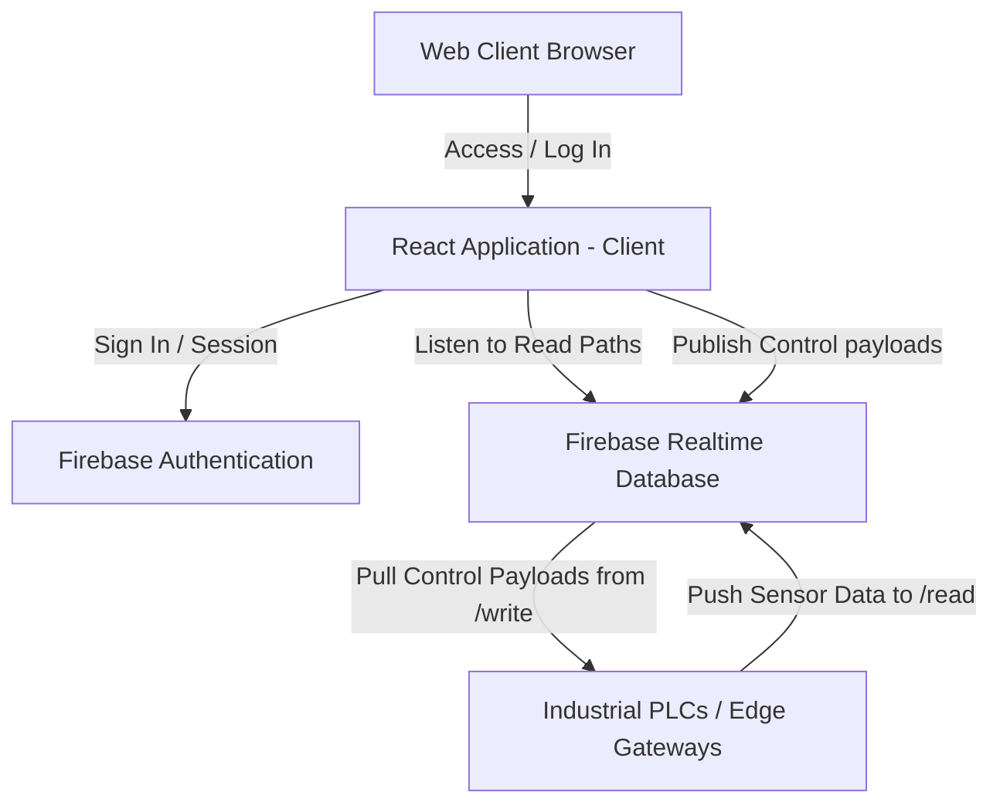

# Project Study: GsBottlecounter IoT Dashboard

Welcome to the comprehensive project study of the **GsBottlecounter** application. This document acts as a developer manual and architectural walkthrough, highlighting how the application operates, integrates with IoT devices via Firebase, maintains state, and presents user controls.

---

## 🗺️ Architectural Blueprint

The application is a **Real-Time Industrial IoT (IIoT) Dashboard** designed to monitor and control industrial machines, chillers, and bottle counters in real-time. It uses a modern serverless web stack:



### 💻 Technology Stack
- **Core Frontend**: React (v18.2.0) & React Router DOM (v6.21.1)
- **Styling**: Tailwind CSS (v3.4.1) & Vanilla CSS for custom components (e.g., custom tables, dashboard metrics)
- **Backend & Database**: Firebase (v10.7.1) using **Authentication** and **Realtime Database (RTDB)**
- **Dev Tools**: React Scripts (v5.0.1) / PostCSS / Autoprefixer

---

## 🔑 Authentication Flow & Session Management

Authentication is tightly coupled to Firebase Auth, ensuring only authorized personnel can view machine metrics or execute write commands to PLC registers.

### 1. Persistent Sessions
The application sets the auth persistence to session-only:
```javascript
// Located in src/firebase/auth.js
setPersistence(auth, browserSessionPersistence).catch((error) => {
    console.error('Failed to set session persistence:', error);
});
```
> [!NOTE]
> This means that closing the browser tab will automatically invalidate the login state, ensuring high security in control-room environments.

### 2. Auto-Signout Mechanism
To guarantee that sessions do not remain lingering under any circumstance, the `Login` component listens to the window `beforeunload` event to perform a clean logout:
```javascript
useEffect(() => {
    const handleTabClose = () => { doSignOut() }
    window.addEventListener('beforeunload', handleTabClose)
    return () => {
        window.removeEventListener('beforeunload', handleTabClose)
    }
}, [])
```

### 3. Context & Guard Rails
- **`AuthProvider`** (`src/contexts/authContext/index.jsx`): Manages the reactive login state, listens to auth status changes via `onAuthStateChanged`, and exposes global parameters like `currentUser` and `userLoggedIn`.
- **`PrivateRoute`** (`src/App.js`): Protects the `/home` route. Unauthenticated requests are gracefully redirected back to `/login`.

---

## 📊 Real-Time Database Structure & IoT Integration

The heart of the application lies in its real-time link with multiple PLCs (Programmable Logic Controllers). The Firebase Realtime Database schema is separated per machine, with each machine containing a `read` branch and a `write` branch:

```
taprw-c7977 (Root RTDB)
 ├── read (legacy root for Machine 1)
 ├── write (legacy root for Machine 1)
 ├── SAFC_M3
 │    ├── read
 │    └── write
 ├── SAFC_M4
 │    ├── read
 │    └── write
 └── SAFC_M6 ... SAFC_M29
```

### 1. The "Read" Lifecycle (PLC ➡️ Firebase ➡️ Dashboard)
PLCs upload telemetry arrays under `/<MachineName>/read`. Each record contains a timestamp `ts` and a `values` payload:
- **Bottle Count**: Tracks output counts (e.g., `bottle_count` and `bottle_count_2`).
- **Temperatures**: Water/chiller temp (values are divided by `10` in the UI to convert integers to decimal degrees, e.g., `235` becomes `23.5°C`).
- **Equipment States**: Digital statuses for the Pump, Fan, and Compressor (`1` = ON, `0` = OFF).
- **Alarms/Trips**: Flow Switch (`fsw_trip`) and Compressor Protector (`kp1_trip`) flags (`1` = OK, `0` = TRIP).

### 2. The "Write" Lifecycle (Dashboard ➡️ Firebase ➡️ PLC)
When a operator flips a control switch (such as "Counter Reset", "Pulse", or "Stop PLC") in the UI, a payload containing a Modbus instruction is sent to the `/<MachineName>/write` node:

```json
{
  "method": "do_mb_write",
  "params": {
    "device_name": "plc_device",
    "write_list": [
      { "data": "0", "data_type": 0, "request_type": 5, "starting_reg_addr": 519 },
      { "data": "1", "data_type": 0, "request_type": 5, "starting_reg_addr": 520 },
      { "data": "0", "data_type": 0, "request_type": 5, "starting_reg_addr": 525 }
    ]
  }
}
```

- **`request_type: 5`**: Corresponds to Modbus Function Code `05` (Write Single Coil).
- **`request_type: 16`**: Corresponds to Modbus Function Code `16` (Write Multiple Holding Registers).
- **`starting_reg_addr`**: Target coil or register address inside the PLC memory map.

---

## 🧩 Component Directory Analysis

The main dashboard is situated at `/home` which aggregates several sub-dashboards:

| Component | Target Location / Machine Numbers | Liters / Type | Key Features Monitored |
| :--- | :--- | :--- | :--- |
| **`Iot.jsx`** | machine 1 - CHITRADURGA | Bottle Counter | Single Bottle count, PLC Status, basic controls |
| **`GSBottle_counter.jsx`** | Machine SAFC_M* (HYD WEST) | Bottle Counter | Dynamic machine list, custom timestamp formatting |
| **`Iotchiller.jsx`** | SAFC_M3 (NAGPUR), SAFC_M4 (NARASARAOPET) | 200L Chiller | Temp (Water), Pump, Comp, Fan, FSW & KP1 Trips |
| **`Iotchiller1.jsx`** | SAFC_M10, SAFC_M11, etc. | 200L Chiller | Standardized 200L tracking, register write triggers |
| **`IotChiller3.jsx`** | SAFC_M6, SAFC_M10..29 (Allowed List) | 300L Chiller | Double bottle counters, multiple register triggers, default reset lists |
| **`IotPhillerPpcl.jsx`** | SAFC_M21, etc. | 60L Philler | Specific coil registers customized for 60L setups |

---

## 🎨 Styling Architecture (`src/components/home/dnm.css`)

The application's aesthetics use an industrial green-and-dark theme which symbolizes green energy, efficiency, and real-time operations.

- **Theme Palette**:
  - Main background containers: Deep Industrial Forest Green (`rgb(3, 78, 31)`).
  - Header Table Backgrounds: Midnight Indigo (`rgb(15, 2, 48)`).
  - Zebra Striping: Alternating dark green (`rgb(4, 54, 26)`) and light rows to elevate tabular readability.
- **Controls styling**: Cards use light grey contrast wraps (`#f8f8f8`) with rounded margins (`border-radius: 8px`), drop-shadows, and bright green trigger buttons (`#28a745` / success) to make writes highly visible.
- **Responsiveness**: Complete media-query coverage from mobile widths (`320px` to `480px`) up to desktop dimensions. Tables shrink font sizes (`10px`) dynamically to prevent horizontal overflow on field devices.

---

## 💡 Code Review & Refactoring Recommendations

As the project scales, implementing the following patterns will drastically improve codebase health:

### 1. Consolidate Duplicate Component Logic
Currently, `Iot.jsx`, `Iotchiller.jsx`, `Iotchiller1.jsx`, `IotChiller3.jsx`, and `IotPhillerPpcl.jsx` share approximately **85% identical code structure** (Firebase hooks, formatting functions, tables, write handlers).
> [!TIP]
> **Recommendation**: Extract a reusable `<ChillerDashboardCard />` component that accepts parameters like:
> - `machineId` (e.g., `"SAFC_M3"`)
> - `machineName` (e.g., `"NAGPUR"`)
> - `chillerCapacity` (e.g., `"200L"`)
> - `defaultWriteList` memory register maps.
> This will reduce lines of code by over **60%** and prevent duplicate bug-fixing sessions.

### 2. Move Database Credentials to Environment Variables
Currently, the sensitive Firebase API keys are committed directly to `src/firebase/firebase.js`.
> [!IMPORTANT]
> **Recommendation**: Transfer configurations into a `.env` file (`REACT_APP_FIREBASE_API_KEY`, etc.) so that credentials can be rotated and are not stored in version control.

### 3. Handle Empty and Loading States Gracefully
In cases where network drops occur inside factories, loading status elements should be visually enhanced.
- Introduce pulse skeletons for the tables.
- Add offline indicator alerts using standard browser connectivity API (`navigator.onLine`).
